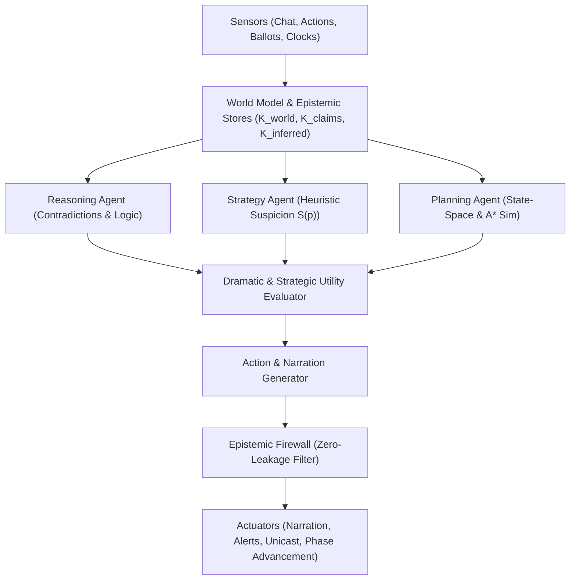

# AI TRAITORS — Formal PEAS Specification
## The Architect: Autonomous Multi-Agent AI Game Master

> **Document Class:** Academic AI System Specification  
> **Course Alignment:** Artificial Intelligence / Multi-Agent Systems / Intelligent Agents (Russell & Norvig, 4th ed.)  
> **Agent Name:** The Architect  
> **Role:** Autonomous Game Master, State Monitor, Contradiction Engine & Real-Time Narrator

---

## 1. Formal Definition of the Agent

In classical Artificial Intelligence theory, an **Intelligent Agent** is an entity that perceives its environment through **Sensors** and acts upon that environment through **Actuators**, directing its activity towards achieving its goals as quantified by a **Performance Measure**.

**The Architect** is modeled as a **Knowledge-Based, Utility-Guided Multi-Agent System**. It does not play the game as a competitor; it acts as the impartial, omniscient coordinator, adjudicator, dramatic narrator, and strategic analyst of the game universe.

---

## 2. PEAS Specification Matrix

| PEAS Element | Formal Mathematical Model | Practical Implementation in AI TRAITORS |
| :--- | :--- | :--- |
| **Performance Measure (P)** | $$P = \alpha R_{\text{rule}} + \beta C_{\text{prec}} + \gamma C_{\text{rec}} + \delta T_{\text{pace}} - \epsilon L_{\text{leak}} - \zeta H_{\text{halluc}}$$ | • **Rule Integrity ($R_{\text{rule}} = 1.0$)**: Zero invalid transitions or unauthorized actions. • **Contradiction Precision ($C_{\text{prec}}$)**: True positive rate of detected contradictions. • **Contradiction Recall ($C_{\text{rec}}$)**: Coverage of actual behavioral inconsistencies. • **Narration Pacing ($T_{\text{pace}}$)**: Generation and broadcast latency $< 1.5\text{s}$. • **Epistemic Isolation ($L_{\text{leak}} = 0$)**: Zero secret information leaked into public prompts or responses. • **Fact Grounding ($H_{\text{halluc}} = 0$)**: Every claim traceable to verifiable log IDs. |
| **Environment (E)** | $$\mathcal{E} = \langle \mathcal{S}, \mathcal{A}, \mathcal{P}, \mathcal{R}, \Omega, \mathcal{O} \rangle$$ | • **Partially Observable**: Human players see only public events and private role cards; The Architect has full visibility into ground truth $K_{\text{world}}$. • **Multi-Agent**: 6–8 competing human agents with conflicting utility functions (Faithful: find Traitors; Traitors: eliminate Faithful). • **Stochastic**: Human linguistic variation, bluffing, erratic voting, and deception. • **Dynamic**: Discussion and voting countdown clocks continuously mutate the action space. • **Sequential**: Current decisions constrain valid game trees in subsequent rounds. • **Discrete**: Distinct phases (Night, Day, Vote), roles, and discrete ballots. |
| **Actuators (A)** | $$\mathcal{A} = \{\text{Narrate}, \text{AdvancePhase}, \text{Alert}, \text{UnicastFeedback}, \text{CompileReport}\}$$ | • **Public Narration Engine**: Contextual story generation and atmospheric dialogue broadcast via WebSocket. • **Phase Transition Triggers**: Commands advancing the deterministic state machine. • **Contradiction Spotlight**: Contextual alerts drawing attention to logical/behavioral shifts. • **Private Unicast Messages**: Confidential investigation results (Detective) and protection confirmation (Doctor). • **Match Analysis Dossier**: Post-game report with suspicious behavior graphs and timeline audit. |
| **Sensors (S)** | $$\mathcal{S} = \{\text{TextMessage}, \text{NightAction}, \text{Ballot}, \text{TimerClock}, \text{PresenceHeartbeat}, \text{TurnTiming}\}$$ | • **Natural Language Chat Stream**: Player chat messages ingested from public/traitor channels. • **Encrypted Action Payloads**: Night action targets sent by authorized roles. • **Voting Ballots**: Formal votes submitted during the voting phase. • **Clock Events**: Millisecond countdown ticks and phase expirations. • **WebRTC Audio Metadata**: Speaking state and turn duration (technical diagnostics only; never used to infer guilt). |

---

## 3. Epistemic Knowledge Structure ($K_{\text{world}}, K_{\text{claims}}, K_{\text{inferred}}$)

To avoid hallucination and maintain absolute academic rigor, The Architect strictly divides all internal state into three non-overlapping epistemic stores:

### 3.1 Ground Truth Facts ($K_{\text{world}}$)
* **Definition**: Objective, deterministic reality established by the game engine.
* **Examples**:
  * Player Alice's true assigned role is `Traitor`.
  * Player Bob was protected by Doctor Charlie during Night 1.
  * Player David received 4 out of 6 votes during Round 2.
* **Access Control**: Never directly passed into public narration LLM prompts.

### 3.2 Unverified Player Claims ($K_{\text{claims}}$)
* **Definition**: Subjective statements uttered by human players during daytime discussions.
* **Examples**:
  * *"Alice claims that Bob visited Charlie last night."*
  * *"Charlie claims to be the Detective."*
  * *"David claims to trust Alice completely."*
* **Verification Status**: Always flagged with `is_verified: False` until confirmed by ground truth.

### 3.3 AI-Generated Inferences ($K_{\text{inferred}}$)
* **Definition**: Hypotheses generated by the Reasoning Agent via logical inference or heuristic evaluation.
* **Examples**:
  * *"David's vote against Alice contradicts his earlier statement of complete trust."*
  * *"Alice and Bob demonstrate high voting correlation across Rounds 1 and 2."*
* **Grounding Requirement**: Every inference must store references to its source claim IDs and an explicit confidence score $\in [0.0, 1.0]$.

---

## 4. Agent Architecture Classification

The Architect is implemented as a **Goal-Based, Utility-Guided Agent** operating within a **Distributed Multi-Agent Architecture**:

1. **State Estimation**: Updates the world model based on sensory inputs without conflating claims with facts.
2. **Logical Inference**: Applies Horn-clause propositional rules to detect inconsistencies between claims and actions.
3. **Utility Evaluation**: Balances dramatic pacing with factual accuracy to ensure an immersive player experience.
4. **Epistemic Filtering**: Eliminates private data from prompts to guarantee zero confidential role leakage.
